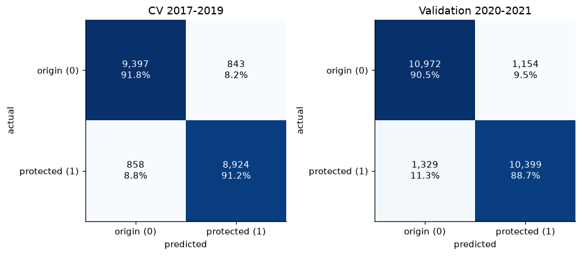
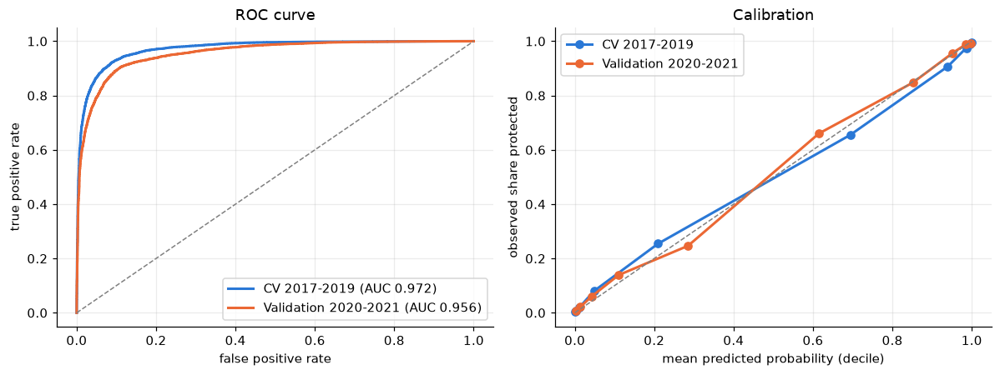
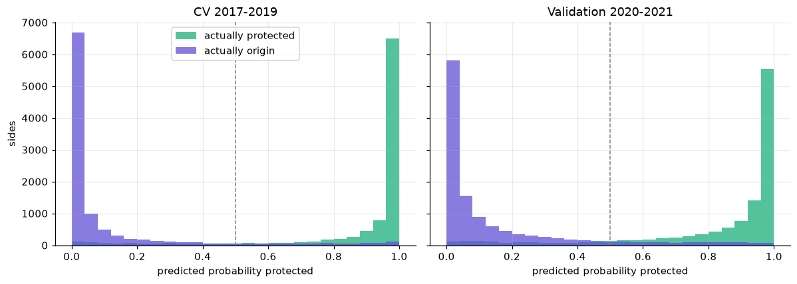
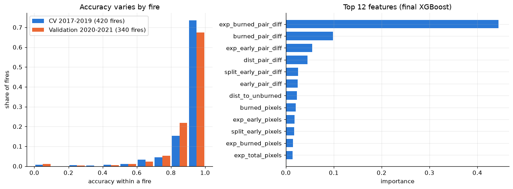

# Wildfire Retardant Drops: Which Side Was Protected?

A geospatial machine-learning pipeline that predicts, for each aerial fire-retardant drop, **which side is the protected side (`pt = 1`) and which is the fire-origin side (`pt = 0`)**. It uses Day-of-Burning (DOB) rasters and the drop geometry.

> **Result:** XGBoost on the final 30-feature set reaches **91.5% ± 0.9%** accuracy in 5-fold, fire-grouped cross-validation (20,022 drop sides from 420 fires), and **89.6%** on an independent set of 2020-2021 drops labeled by different people. The simple rule baseline reaches 68.9%.

Detailed documentation: [data dictionary](docs/data_dictionary.md) · [methodology](docs/methodology.md)

---

## Contents
1. [Problem](#problem)
2. [Data](#data)
3. [Pipeline](#pipeline)
4. [Feature engineering](#feature-engineering)
5. [Modeling](#modeling)
6. [Results](#results)
7. [Repository structure](#repository-structure)
8. [Reproducing this work](#reproducing-this-work)
9. [Limitations](#limitations)
10. [Contact](#contact)

---

## Problem

Each retardant drop is stored as **two buffer polygons** (`buff_id` 1 and 2), one on each side of the drop line. The task is to decide which side is protected (`pt = 1`) and which is the fire-origin side (`pt = 0`).

Pilots drop retardant ahead of the fire, so the protected side should have more unburned area, and the origin side should have more area that burned before the drop. The features measure this at several spatial scales.

## Data

| Data | Description |
|---|---|
| Drop polygons | `data/raw/buffered_drops/cleaned_drop_buffers.shp`: 21,234 polygons across 424 fire events. Every polygon matches a DOB raster. |
| DOB rasters | `data/raw/DOBs/`: 444 per-fire GeoTIFFs (`<Evnt_ID>.dob.tif`). Pixel values are the day-of-year a pixel burned; `65535` marks pixels that never burned. CRS EPSG:5070. 20 of the 444 fires have no drops in the shapefile. |
| Wind | `data/raw/th/` (wind direction, 2017-2019) and `data/raw/vs/` (wind speed, 2017-2021): NetCDF, variables `wind_from_direction` and `wind_speed`. |
| Other data in `data/raw/` | LANDFIRE fuel, MTBS mosaics and DEM tiles were used in the `notebooks/exploratory/` experiments only. VPD is present but unused. |
| 2020-2021 drops | Separate state shapefiles, combined and used for validation in `notebooks/exploratory/04_validation_2020_2021*.ipynb`. |

All data was provided by the professor. The training labels were assigned by the professor; the 2020-2021 validation labels were assigned by students.

Raw data is about 8.7 GB and is not tracked in git (see `.gitignore`).

## Pipeline

```
Notebook 01  Data preparation    drops shapefile + DOB rasters -> data/interim/drops_clean.geojson
Notebook 02  Feature extraction  -> data/features/train/training_features_{dob,split,dist,expanded}.csv
Notebook 03  Modeling            rule baseline -> Random Forest -> XGBoost, saved models in models/
Notebook 04  Validation          final XGBoost scored on the 2020-2021 drops (data/features/val_2021/)
Notebook 05  Analysis            scores, confusion matrices, ROC, calibration, per-fire accuracy, feature importance
```

**Notebook 01: data preparation**
- Loads the drop shapefile and matches every drop to its DOB raster by `Evnt_ID`.
- Reprojects the drops to the raster CRS (EPSG:5070).
- Builds `local_date` from the year/month/day fields and `drop_doy` (day-of-year of the drop), so the drop date is directly comparable with the raster's burn days.
- Builds `drop_id` from event ID, latitude, longitude and UTC timestamp, and checks that drops group into pairs of rows.

**Notebook 02: feature extraction.** See below.
**Notebook 03: modeling.** See [Modeling](#modeling).
**Notebook 04: validation** and **Notebook 05: analysis.** See [Results](#results).

---

## Feature engineering

Features describe when pixels burned relative to the drop date (`drop_doy`):
- **early pixels** burned before the drop: the fire was already there (origin side).
- **late pixels** burned after the drop: the fire arrived later (protected side).
- **unburned pixels** never burned (protected side).

A pixel that burned on the drop day counts as neither early nor late (strict `<` and `>` comparisons).

### 1. Local DOB features
For each buffer polygon, the DOB raster is cropped to the polygon (`rasterio.mask`) and summarized: `mean_dob`, `median_dob`, `early_pixels`, `late_pixels`, `unburned_pixels`, `total_pixels`, `burned_pixels`.

Mean per class:

| | `unburned_pixels` | `early_pixels` | `burned_pixels` |
|---|---|---|---|
| `pt = 0` (origin) | 181.3 | 16.0 | 89.8 |
| `pt = 1` (protected) | 211.7 | 4.4 | 49.3 |

Models using only these local features plateau around 81%.

### 2. Raster-split features (whole fire)
1. The drop line is the **shared boundary** (intersection) of the two buffer polygons.
2. It is extended 500 km in both directions (`extend_line`).
3. The raster's bounding box is split into two halves with `shapely.ops.split`.
4. Each half is matched to a `buff_id` by testing which half contains polygon 1's centroid.
5. The same statistics are computed over each whole half, with a `split_` prefix.

Mean `split_burned_pixels` is 156,963 for `pt = 0` vs 56,382 for `pt = 1`. This was the largest single driver of improvement, taking the combined model from about 81% to about 90%. The split geometry was checked visually, in a plot in Notebook 2 and in QGIS.

### 3. Expanded-polygon features
On irregularly shaped fires, the whole-raster split can capture unrelated fire arms. To keep the context large but local, each half is intersected with a circle centered on the drop-line centroid with radius = **25% of the raster diagonal**. Features carry an `exp_` prefix. In the final XGBoost model, `exp_burned_pair_diff` is the top-ranked feature (importance about 0.43).

### 4. Distance to nearest unburned pixel
A distance transform (`scipy.ndimage.distance_transform_edt`) of the burned mask, multiplied by the pixel size, is sampled at each polygon centroid (`dist_to_unburned`). The protected side sits closer to unburned ground: mean 398.0 m for `pt = 1` vs 467.7 m for `pt = 0`.

### 5. Paired-difference features
A feature is also expressed relative to the drop's two sides: `feature - mean(feature over the two sides)`. Comparing the sides matters more than absolute values, and the paired difference is self-normalizing across drops of very different sizes. It is built for the unburned, early and burned counts at the local, split and expanded scales, and for the distance feature.


---

## Modeling

- **Target:** `pt` (1 = protected, 0 = origin).
- **Rows:** only drops with exactly two rows (`drop_id`); drops with other row counts (about 2.4%) are ambiguous pairs and are excluded. Missing `mean_dob`, `median_dob` and `split_mean_dob` are filled with 0 (a polygon with no burned pixels is still a valid example). After dropping other NaN rows, 20,022 rows from 420 fires remain.
- **Validation:** `GroupKFold`, 5 folds, grouped by fire (`event_id`) so that drops from one fire never appear in both train and test.
- **Models:** Random Forest (200 trees) and XGBoost (200 trees, `max_depth=6`, `learning_rate=0.1`), both with `random_state=42`. **XGBoost is the final model.** The Random Forest is also saved in `models/` for comparison.
- **Final feature set (30 features):** 7 raw local + 3 local paired-difference + 2 distance + 9 split + 9 expanded.

## Results

5-fold fire-grouped cross-validation:

| Approach | Accuracy |
|---|---|
| Simple rule (side with more unburned pixels is protected) | 68.9% |
| RF, raw features only | about 68.4% ± 1.2% |
| RF, paired-difference only | about 80.0% ± 1.4% |
| RF, raw + paired-difference (DOB best) | 81.1% ± 0.7% |
| RF, split features only | about 84.0% ± 2.5% |
| RF, DOB + raster split | about 89.8% ± 0.9% |
| RF, DOB + split + distance + expanded polygon | 91.4% ± 1.0% |
| **XGBoost, full feature set (final)** | **91.5% ± 0.9%** |

Random Forest and XGBoost converge on the same accuracy, which points to a data limitation rather than a modeling limitation.

**Validation on 2020-2021 drops** (`notebooks/exploratory/`), student-labeled and from different years than the training data:
- `04_validation_2020_2021.ipynb`: the earlier DOB + split model (cross-validation accuracy about 90.1%) scored **90.02%**.
- `04_validation_2020_2021_v2.ipynb` and `notebooks/04_validation.ipynb`: the final 30-feature XGBoost model scored **89.6%**, about 2 points below its cross-validated 91.5%. This is on the 2020-2021 clean-pair rows with complete features (23,854 rows, 12,145 drops, 340 fires).

`notebooks/05_analysis.ipynb` compares the two evaluations beyond accuracy (the figures below are from it): precision, recall, F1, ROC AUC, MCC, log loss and Brier score, confusion matrices, ROC and calibration curves, the confidence of wrong predictions, drop-level consistency, per-fire accuracy and feature importance.





| Score | CV 2017-2019 | Validation 2020-2021 |
|---|---|---|
| Accuracy | 0.915 | 0.896 |
| Precision | 0.914 | 0.900 |
| Recall | 0.912 | 0.887 |
| F1 | 0.913 | 0.893 |
| ROC AUC | 0.972 | 0.956 |
| MCC | 0.830 | 0.792 |
| Log loss | 0.217 | 0.269 |





**Error analysis** (`notebooks/exploratory/03_modeling.ipynb`, on the DOB + split model at about 90.1%): 317 wrong predictions are saved to `outputs/failed_predictions.csv`. Two failure modes:
1. The local-buffer and raster-split features disagree (about 25% of wrong predictions).
2. Complex or irregular fire shapes break the whole-raster split.

The distance and expanded-polygon features were added to address these.

---

## Repository structure

```
wildfire/
├── notebooks/
│   ├── 01_data_preparation.ipynb
│   ├── 02_feature_extraction.ipynb
│   ├── 03_modeling.ipynb
│   ├── 04_validation.ipynb
│   ├── 05_analysis.ipynb
│   └── exploratory/        # earlier iterations, fuel/pre-drop/DEM experiments, 2020-2021 validation
├── outputs/                # failed_predictions.csv / .geojson (not tracked in git)
├── models/                 # trained models (not tracked in git)
├── data/                   # raw / interim / features (not tracked in git)
└── docs/                   # data dictionary, methodology, figures/
```

Notebooks find the project root as the nearest parent folder containing `.git`.

**Libraries:** GeoPandas, Rasterio, Shapely, xarray, pyproj, NumPy, pandas, SciPy, scikit-learn, XGBoost, Matplotlib, joblib, tqdm.

## Reproducing this work

The input data is not included in this repository. To reproduce the results or discuss access to the data, please contact me (see [Contact](#contact)).

## Limitations

**Labels**
- Labels (`new_pt`) are assigned manually. Some of the remaining errors may be mislabeled examples. The student-labeled 2020-2021 data reproduces the training accuracy almost exactly, which argues against widespread mislabeling, but a spot-check of the hardest error cases is still outstanding.
- About 2.4% of drops (those without exactly two rows) are excluded as ambiguous pairs.

**Data and features**
- Burn day and drop date are whole days. The drop date is built from year, month and day fields only, and pixels that burned on the drop day are counted as neither early nor late.
- The drop line is treated as straight: its direction comes from its first and last coordinates, and for a multi-part line the longest segment is used.
- The expanded-polygon radius (25% of the raster diagonal) is a fixed parameter that has not been varied.
- Not every row gets every feature. 20,582 of 21,081 rows have split features; the split extraction skipped 162 rows and the expanded extraction skipped 164, and the cause of each skip isn't tracked.
- DEM terrain features are unfinished because of USGS download issues. Fuel, pre-drop, MTBS and fire-start-angle features were explored in `exploratory/` but are not in the final model.


**Evaluation**
- Only accuracy is reported (no precision, recall, F1, ROC or confusion matrix).
- Hyperparameters are fixed; there is no hyperparameter search.
- The error analysis was run on the earlier DOB + split model, not the final one.

## Contact

For questions, feedback, or to discuss reproducing the pipeline or access to the data, please reach out through my GitHub profile, [@SulavSapkota2060](https://github.com/SulavSapkota2060), or open an issue on this repository.
